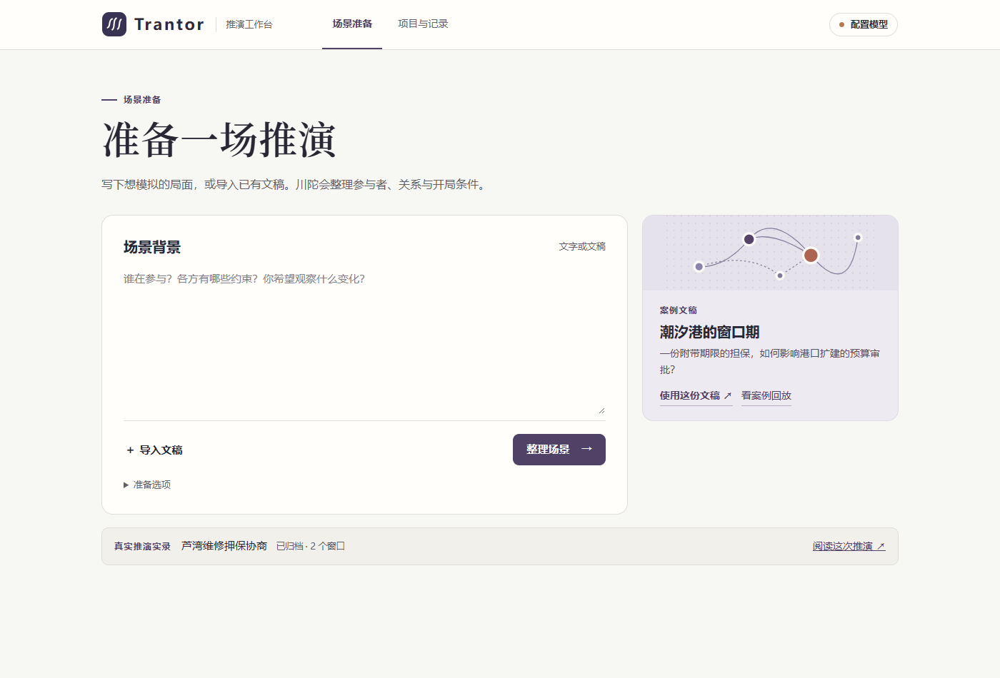

# Trantor

> **本项目仍处于初步开发阶段。**

Trantor（川陀）是一个在本机运行的 AI 沙盘。输入背景或导入 Markdown 文稿，审阅参与者、关系和假设，即可推演。主体可以跨层级沟通，各自决定如何回应。每个时间窗口结束时，世界系统统一审查后果。回看一次变化，可以查到对应的行动原文、当时的可见信息和产生结果的提交记录。



## 安装与启动

使用 Python 3.12。先下载仓库或用 Git 克隆，再进入项目目录。

```sh
git clone https://github.com/Galaxiia1123/Trantor.git
cd Trantor
```

Windows 用户可在项目目录执行以下命令。

```powershell
py -3.12 -m venv .venv
.\.venv\Scripts\python -m pip install -c requirements.lock.txt .
.\start-workbench.ps1
```

安装后也可双击 **启动川陀.cmd**。启动器打开本机的 [推演工作台](http://127.0.0.1:8767)。同一资料目录只允许一个工作台服务写入。命令行可指定其他端口和资料目录。

```sh
python3.12 -m venv .venv
.venv/bin/python -m pip install .
.venv/bin/python -m chuantuo serve --port 8767 --runs ./runs
```

依赖锁对应 Windows / Python 3.12 验收环境。服务默认仅监听本机，适合单用户使用。

配置好工作台模型后，也可以在命令行提交文稿。命令返回已保存的场景链接，可在浏览器审阅并启动。输出的任务编号可用于恢复等待，避免重复整理或建立重复项目。

```powershell
.\.venv\Scripts\python -m chuantuo prepare examples/conditional-review.md --port 8767
# 恢复同一份整理结果
.\.venv\Scripts\python -m chuantuo prepare --resume-job <任务编号> --port 8767
```

## 第一次推演

1. **先看案例。** 首页“真实推演实录”收录了芦湾两窗协商的真实模型推演节选，点开报告编号可核对材料、发言和结算。“看案例回放”提供潮汐港的九窗脚本记录，适合逐步观察跨层互动。两种回放都无需密钥，阅读时没有新模型调用。
2. **配置一次模型。** 点击右上角“配置模型”，选提供商，填账户可调用的模型标识和密钥。兼容接口还要填 API 地址。场景整理、主体决策、世界结算、报告与追问共用此配置。各主体只接收自己的信息。设置页保存参数，首次整理时才发起模型请求。
3. **提交材料。** 输入背景或直接导入文稿，二者可单独使用。点击“整理场景”，先看开局摘要、主体数、窗口数和预计基础调用次数。可以展开有向关系、假设和来源，也可修改运行方案。项目保存为本地版本。
4. **启动与观察。** 点击“启动推演”。选择窗口可查看当时的处境、定向投递和客观后果。点记录编号看原文。暂停在结算边界生效，运行到设定窗口数会自动结束。
5. **回顾结果。** 在暂停或结束后生成报告，点击结论旁的编号即可查证。报告可下载为 Markdown。追问可以限定在一个主体当时可见的记录内。需要比较另一种开局时，可从已提交窗口另存场景。

## 接口与密钥

支持 OpenAI、Anthropic、DeepSeek 及兼容接口。高级连接设置支持 Chat Completions、Responses 或 Messages 协议。模型标识由用户填写。调用出错会给出失败状态，未通过校验的窗口保留在记录中，可从最后一次提交显式重试。

新选 DeepSeek 时，界面预选关闭额外思考，适用于频繁、简短的结构化决策。可在高级连接设置中改用接口默认或指定思考强度。输出达到上限的请求可能已计费；系统会记录用量并显示失败。[DeepSeek 思考模式](https://api-docs.deepseek.com/guides/thinking_mode/)

在 Windows，界面填写的密钥由当前系统用户的 DPAPI 加密后保存在本机，限定于所选提供商和地址。其他系统的界面密钥只在本次服务进程内有效。官方接口也可使用启动进程的环境变量 `OPENAI_API_KEY`、`ANTHROPIC_API_KEY` 或 `DEEPSEEK_API_KEY`。自定义的本地无鉴权服务可以留空。把密钥填在专用输入框中，文稿、项目包与报告不需要密钥。项目中可导出模型标识、接口地址和凭据引用，迁往另一台机器时需在当地设置凭据。

也可向本机的 `PUT /api/model` 提交一份配置。示例中的本机地址、模型名和环境变量名均为占位设置。请换成自己可用的接口和模型，并在本机设置环境变量。[单模型配置示例](examples/model-profile.example.json)

## 场景与资料补全

- 每次整理都检查背景边界、主体和偏好、领域和字段、包含关系、有向关系、规则与可见性、时间和目标。文稿足够时直接生成摘要。关键冲突集中提问。
- 世界规则可以只提供给世界、向指定主体公开，或广播给所有主体。准备时交叉检查可识别的私有原文和显式保密短语。文稿明确列出结算字段时，额外提议默认保留为主体资料，纳入结算前可逐项采纳。能够从原文确认的直接关系保留方向、描述与原句。
- 私有资料的开局读者需要明确的既有知情依据。拟发送的消息在实际投递后才能成为收件人的记忆。资料还可单独设置保密短语的传播名单，收件越权时，原尝试留在审计记录，主体按运行方案修正后才可投递。字面匹配能拦截配置中指定的原文；对转述还须结合上下文和运行记录判断。
- 仅为需要的公开事实发起检索，可在“准备选项”里关闭。网页检索使用公开索引发现候选，读取公共 HTTPS 原页正文。文献使用 Crossref，已知 DOI 可直接核对登记信息。公开服务的可用性、覆盖和时间信息会影响能采用的资料。可通过环境变量 `CHUANTUO_SEARCH_ENDPOINT` 指向自己的 SearXNG JSON 搜索端点。检索过程和未采用的候选保存在准备记录中。[Crossref REST API](https://www.crossref.org/documentation/retrieve-metadata/rest-api/)
- 采用外部事实需要查询、来源、适用时间的判断、实际引文以及对应的场景定义。未能核对的内容保留为缺失或模拟假设。每次最多发出四条公开查询。外部检索会发送模型提取的检索词，处理敏感或纯虚构场景时可以关闭。
- 入口支持 Markdown、文本、DOCX、PDF；V1.1 整理使用导入后提取的文字。PDF 可逐页提取或 OCR，复杂图表的视觉语义需要用户补充。长文在上下文允许的范围内分批选取逐字引文，原件及页码保存在本机。
