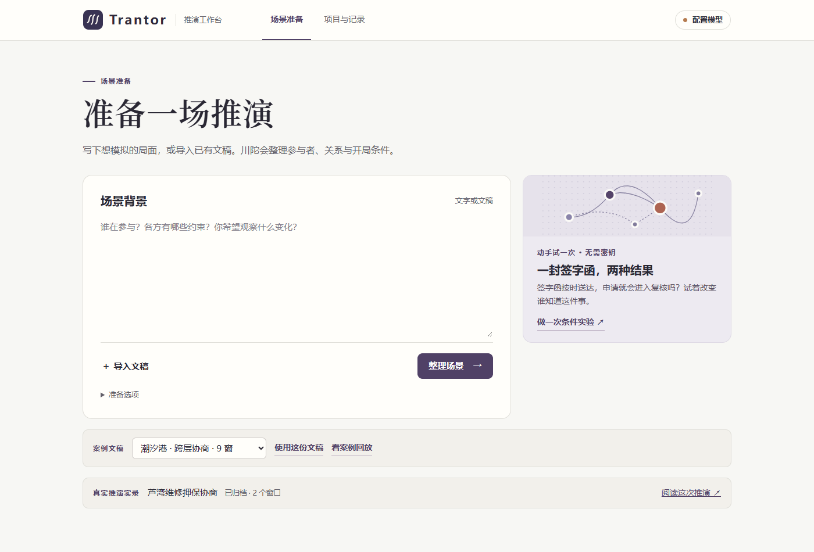
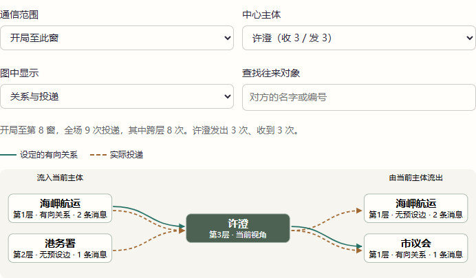

# Trantor

> **本项目仍处于初步开发阶段。**

Trantor（川陀）是一个在本机运行的 AI 沙盘。输入背景或导入 Markdown 文稿，审阅参与者、关系和假设，即可推演。主体可以跨层级沟通，各自决定如何回应。每个时间窗口结束时，世界系统统一审查后果。回看一次变化，可以查到对应的行动原文、当时的可见信息和产生结果的提交记录。



## 安装与启动

使用 Python 3.12。先下载仓库或用 Git 克隆，再进入项目目录。

```sh
git clone https://github.com/Galaxiia1123/Trantor.git
cd Trantor
```

Windows 已安装 Python 3.12 后可直接双击 **启动川陀.cmd**。首次启动会为本项目建立独立环境并下载依赖。也可在项目目录手动安装。

```powershell
py -3.12 -m venv .venv
.\.venv\Scripts\python -m pip install -c requirements.lock.txt .
.\start-workbench.ps1
```

启动器会打开本机的 [推演工作台](http://127.0.0.1:8767)，默认端口已被占用时会选择附近的可用端口并显示实际地址。同一资料目录只允许一个工作台服务写入。命令行可指定其他端口和资料目录。

```sh
python3.12 -m venv .venv
.venv/bin/python -m pip install .
.venv/bin/python -m chuantuo serve --port 8767 --runs ./runs
```

依赖锁对应 Windows / Python 3.12 验收环境。服务默认仅监听本机，适合单用户使用。

配置好工作台模型后，也可以在命令行提交文稿。命令返回已保存的场景链接，可在浏览器审阅并启动。输出的任务编号可用于恢复等待，避免重复整理或建立重复项目。

```powershell
.\.venv\Scripts\python -m chuantuo prepare examples/conditional-review.md --port 8767
# 恢复同一份整理结果
.\.venv\Scripts\python -m chuantuo prepare --resume-job <任务编号> --port 8767
```

## 第一次推演

1. **先做一次条件实验。** 首页的“签字函”可以改变谁获知送达。“货运封存单”可以缩短邮程，也可以让发货站只寄进度说明。两种案例都能回看原路线、收件凭据和各方决定，在本机使用规则脚本，无需密钥。另有潮汐港九窗脚本回放和芦湾两窗真实模型实录可读。
2. **配置一次模型。** 点击右上角“配置模型”。可选“ChatGPT 订阅 · Codex CLI”，使用本机 CLI 已登录的账户。也可选 API 提供商，填账户可调用的模型标识和密钥，兼容接口还要填 API 地址。场景整理、主体决策、世界结算、报告与追问共用此配置。各主体只接收自己的信息。设置页保存参数，首次整理时才发起模型请求。
3. **提交材料。** 输入背景、导入文稿，或通过“导入网页”加入指定公开资料。点材料名称可在整理前阅读。网页保留当时提取的正文、原网址和读取日期，可下载文字快照；静态 HTML 和纯文字支持直接读取，超出 512,000 字节会标出截取范围。点击“整理场景”，先看开局摘要、主体数、窗口数和预计基础调用次数。可以展开有向关系、假设和来源，也可修改运行方案。项目保存为本地版本。
4. **启动与观察。** 点击“启动推演”。选择窗口可查看当时的处境、定向投递和客观后果。点记录编号看原文。暂停在结算边界生效，运行到设定窗口数会自动结束。
5. **回顾结果。** 在暂停或结束后生成报告，点击结论旁的编号即可查证。报告可下载为 Markdown。追问可以限定在一个主体当时可见的记录内。打开“试一个条件”，选择原路线里已经走过的一段，改变一件事或按原样重跑。分岔前的状态、各主体的记忆和收件记录会保留，原路线无需再调用模型。新路线会标出最早出现字段差异的窗口，可以直接比较双方当时的决定。

“项目与记录”按来源把相关路线放在一起。每组显示最近更新的结果，展开可查看各次分岔的位置、模型和状态，沿来源链接返回当时。搜索名称、条件、模型或运行编号，可直接定位一条路线。

可以用“栖灯手册”试一次网页导入。选中文稿下的 IANA 地址并读取正文，整理后打开“资料与依据”，就能看到哪些设定逐字引用了该页。点设定可在保存的快照中核对引文的上下文。[栖灯手册文稿](chuantuo/templates/example-domain-guide.md)

“林湾蓄水柜”讨论多个主体如何分用同一份容量。共享上限引用已定义的数值字段或明确的固定容量，每窗对整体结果同时校验。单方申请不会自动成为实领，未知占用会标明。观察页可查看占用、余量及组成项的依据，也可从开局改变容量后再比较。约束的知情范围与各项实际数据的读权分别保存。[蓄水柜文稿](chuantuo/templates/water-allotment.md)

主体写信时可以请对方回函，并表达希望收到答复的窗口。出现这类问询后，在“事件经过”点“查看回函”，可区分原信在途、已送达等待回复、回复寄出和实际收回。答复由收件人自行决定。可用“桦湾演出单”比较不同回程邮速下，回函是否如期送达。[演出单文稿](chuantuo/templates/proof-reply.md)

如果只有一封已寄出的邮件加急，在邮路记录点“只调整这封信的到件日”。新路线保留发件凭据、正文、附件和回函截止日，承接分岔点的状态。其他邮件仍走原邮程。回看已经送达的邮件也可以从它尚在途的时点重新比较。

对文稿里明确写出的“开局仅某方知道‘某段文字’”，以及点明收件后才可读的具名来信，整理时会核对相应主体真实可见的开局输入。可在“资料与依据”中查到命中的原句、知情主体和等待收信的主体。

观察页默认先显示本窗变化、简短对照和通信预览。长段落可展开原文，已经恢复的未提交尝试单独折叠保留。切到“展开全部原文”可以连续阅读所有内容，窗口切换条在滚动时保持可见。

一个主体请求失败时，系统保存各主体本轮已经形成的私有观察和已完成的结果。恢复时只复用模型输入完全一致的结果，其余主体继续按原配置请求。所有主体就绪后统一记下行动和投递，已完成的前几轮也会保留。运行中断到尚未形成这份记录时，按已提交边界恢复。

在观察页可把已有字段固定为问题，例如“第 3 窗前，排练室是否完成交换登记”。观察台从已提交记录找出首次达成和后续变化，点依据即可回到原记录。也可以按主体回看仍在跟进、修订或已结清的事项。以上查询都在本机完成。[排练室文稿](chuantuo/templates/rehearsal-room.md)

观察页的局势时间带标出哪些窗口有字段变化、通信或外部事件。窗口多时先选一段放大。主体处境旁的“全场动向”可按人查找、放大时间段，再跳回这一刻的决定与观察。点击“为什么发生变化”可以直接阅读这一项字段的前后值、世界系统给出的理由和它引用的原话，再打开当事主体当时的收件箱。查询使用既有记录，无需调用模型。[查看字段解释界面](docs/field-reason.png)

需要等到某个具体结果时，可在“添加关注”里指定目标，再选“达到这个条件时暂停”。也可在启动前的“准备追踪的问题”中，为具体目标勾选“达成后暂停”。系统在后续目标出现的窗末暂停一次，条件可取消、设置期限，重启后仍保留。查看结果后可继续推演。

运行结束后，观察页顶部列出截至所选时点的关注结果，点击即可查看对应字段的历程与依据。

生成报告时会带上已固定的关注问题。报告开头按提交记录列出结果和首次达成时间，区分尚在观察、未出现、未知以及期限未走完的情况，再解释相关行动与约束。生成前确认的问题随报告保存，之后修改观察卡不会改写旧报告。下载 Markdown 或导出回放时也会保留这些结果。

在主体的“决策现场”选择窗口内的轮次，再点“就这一轮追问”，可以问它当时收到什么、为何采取这一步。回答附上它作决定时实际收到的输入和作出的表达，可沿引用返回原文。较长的输入会节选。访谈单独保存，后续推演仍沿用主体原来的记忆。

在“主体处境”点击名字，进入它的手记。左侧按轮次展示它已收到的信、实际附件和可见状态变化，右侧展示它随后作出的选择。可以只停在有新见闻的轮次，查阅当时已经持有的文书，或在一次决定旁直接从该窗口开始前分岔。未签收的副本直到实际进入该主体的收件箱后才可查阅。

“改变开局初值”适合探索另一项委托条件。比如把栖灯手册的版面用途从“用作示例”换成“用作联系地址”，各主体从第一轮就按自己的读权看到新开局，编辑部仍可独立签发或退回。运行期间固定的字段也可在这种实验中选择另一个合法初值；需要在指定窗口才能转入的结果仍受期限约束。

在两条路线的比较中打开“对照简报”，选一项关心的结果。简报把分岔起点、该字段首次出现差异的窗末和所选终点并排放置。可以顺着结算理由读行动原文、查看当事人当轮所见，也可下载带两侧记录编号的 Markdown。使用已保存的推演记录即可阅读。

单条条件对照可以展开“首轮判断的对照方式”，选择在信息完全相同时沿用原路线的判断。只核对分岔后第一窗的第一轮，模型配置、完整输入及引用均须一致，并重新检查消息与文书权限。有变化的主体照常请求模型。记录标出原判断，费用栏分别显示沿用数量与新调用。该选项默认关闭，重复实验使用独立判断。

“导出回放”生成一份能用浏览器直接打开的 HTML，收录截至指定窗口的状态、消息、主体观察与已有报告，也可随附原路线并排查看。文件包含观察者可读的私有资料，分享范围由用户决定。导出会清理接口地址和密钥引用，文件本身只读。

想比较同一个条件的多个数值，可从“试一个条件”选“设定一个字段的新值”，展开“同时比较这个字段的多个取值”。例如在“榆街社区夜课”里分别把可用席位设为 6、12、18 个，观察字段选“开班进度”。启动前可以查看共有多少条路线、设置每档重复次数和全组调用上限；结果按档展示，并可挑两条路线核对当时的决定。

如果到了原定终点，谈判还在进行，或有信件仍在途中，可以点“延长观察”，指定再看几窗和新增调用上限。川陀从最后一次结算另开路线，保留各主体的所见、记忆、等待安排及在途信件，只为新增窗口调用模型。可以回看延长前后的状态，也可以单独打开原来的报告或实验组。

更换模型后，可以在已暂停、失败或结束的路线中点击“用当前模型继续”。确认后从最后一次提交另开路线，保留记忆、在途信件和仍在观察的暂停条件。工作台及报告会记录更换模型的窗口，历史窗口显示当时的模型。该功能也可用于从 DeepSeek 路线继续使用本机 ChatGPT 订阅 CLI。前后行为变化需要结合模型和配置的变化一起解释。

“试一个条件”也可取消一项在分岔时尚未发生的预定事件。取消会撤销该事件的预设通知与字段赋值，主体继续依据自己的信息行动。日历列出已取消的原定安排及其依据，可据此比较公告未发、听证未举行等情境。

“已开班”可以指书房完成报名登记，也可以指已经有学员上完第一节课。在文稿中用“主体、字段、候选值、判定口径”四列表格说明采用哪一种含义，或在场景准备里展开“结果怎样才算成立”编辑。回看时，打开字段的结算依据，选“用不同口径读这一窗”。系统用相同的当窗行动和实际收件分别判读，显示各自的引用和证据不足之处。原路线的提交值和这次判读分开保存。

比较两条路线时，展开“并排查看主体的决定”，选择主体后可查找它从哪一轮开始不同。系统分别比对它所见的信息、等待与发信方式，以及决定原文。即使最后登记值一致，也能核对某封信、某个可见状态或一次复看安排在何时出现差异。此操作只读取已有记录。

观察时想到新问题，可以点“问一个如果”，直接写下要改的条件和想看的结果。明确的数值和日期先在本机匹配，需要理解开放表述时可用当前路线的模型拟定一次。工作台会列出可修改的字段或事件、初始知情范围、观察终点和调用估算。自己选定并启动后才产生新的推演路线。

临时规定可以设置最后有效窗口。例如备用排练室仅在第 2 窗可借用，可以继续观察到第 4 窗。知情主体在有效期内看到条件，到期时会看到结束提示；期间作出的决定和交付的消息保留在各自的记录中。日历可查看每项临时条件的生效时间和告知对象。

主体可以针对一封确实收到的来信向原发件人答复。在通信图的双方往来中点击“沿这封信读回复”，能看到原信、后续答复和仍在途中的回信。同一对主体之间的其他话题仍按各自的消息记录展示。

“查看通信图”可以按窗口和主体区分设定的有向关系与已经送达的消息。打开双方往来，可以查到发送时的决定、投递原文，以及收件人首次在观察中看到该消息的轮次。若从同一时刻另开路线，也可以指定一个可调整字段的新值，直接比较数值或文字状态的差异。

想知道同一个结果能否再次出现，可以在“试一个条件”里把新路线数量调到两条或以上，选一个终点字段或已经固定的观察问题。例如，从排练室第二窗末按相同条件再跑三次，数一数有几次最终登记为“已交换”。每条路线独立延续当时的记忆。实验组只统计到达共同终点的路线，点每一条都能回看过程。全组共享主体与世界调用上限，格式纠正也占用次数。暂停在窗口边界生效，关闭后可从“项目与记录”找回并手动继续。

文稿里已经提出“如果……”的问题时，场景整理可以同时拟出待试方案。开局摘要中可查看改哪一项、比较哪些窗口及引用的原句。原路线到达终点后，在观察页点“按这个问题对照”，可以直接审阅、修改并启动。也可以将一项尚未发生的日历事件改期，沿用它的通知范围和预定字段值。

要比较两种条件各自的波动，可以勾选“也按原条件运行相同次数”。每轮从同一提交分别运行两种条件，先后顺序轮换。两组分别统计完成数和结果次数，数值终点还显示已知值的中位数和范围。点击计数可找到对应路线，也可从两组各挑一次运行，并排看首次分化的窗口及主体决定。“下载实验记录”会导出带运行及证据编号的 Markdown。



主体可以在作出决定时安排短暂等待。引擎每轮仍向每个主体提供观察。新收件、该主体可见的处境变化、已登记的事项期限或约定复看时间会触发重新判断。沿用等待的轮次单独列出，不会重新发送承诺或消息。高级运行方案中的等待上限设为 0 时，每轮都请求主体模型。

场景还可以安排定时发生的外部事件。选定的主体在窗首收到通知，明确指定的字段值在窗末统一提交。其他主体仍按原有权限观察结果。结算记录区分了主体行动与外部事件，能追到各自的出处。[钟楼天台文稿](chuantuo/templates/roof-calendar.md)

消息可以跨窗在途。例如，一条线路耗时两窗，第 1 窗寄出的消息会在第 3 窗开始时送到，收件人在此前的决策里看不到原文。两条方向可设置不同的送达时间。“查询在途与到件”可以回到某个时点，核对发件决定、到件凭据和收件人的首次观察。在条件实验中缩短线路时效，只影响分岔后新发的消息。[山线货运站文稿](chuantuo/templates/mountain-mail.md)

场景材料中明确给出正文的凭证可登记为原件，也可以在“资料与依据”中自行登记。主体只能附寄当时持有且获准转交给收件人的原件副本。每次交付保留原文和内容指纹。打开“原件流转”可以按窗口查看谁已持有、哪些副本仍在途中。单份正文上限为 1,200 字，每封信最多附四份。

当“按期”与“逾期”有明确边界时，可在文稿或高级编辑里限定某个文字候选值最早、最晚能在哪一窗转入。窗口过后仍可保持原值。世界模型如果提议逾期转入受限值，引擎会拒绝该次结算，按运行方案修正或暂停。

## 接口与密钥

支持 ChatGPT 订阅的 Codex CLI，以及 OpenAI、Anthropic、DeepSeek 和兼容 API。高级连接设置支持 Chat Completions、Responses 或 Messages 协议。模型标识由用户填写。调用出错会给出失败状态，未通过校验的窗口保留在记录中，可从最后一次提交显式重试。

使用订阅时，先安装 Codex CLI，运行 `codex login` 并选择 ChatGPT 账户。在模型设置中选订阅 CLI，界面会检测本机登录和已配置的模型名称。CLI 须支持 `exec --ignore-user-config`、`--ephemeral` 和 `--output-last-message`，本项目已用 `0.166.0-alpha.5.1` 验证。也可通过本机环境变量 `TRANTOR_CODEX_BIN` 指定原生可执行文件。调用消耗该账户的订阅额度。[Codex 登录说明](https://learn.chatgpt.com/docs/auth)

每次 CLI 请求使用独立临时目录和临时会话，设置禁用工具、项目说明、技能与历史记忆。川陀传入本次任务所需的文字，并保存最终回答及用量。认证由本机 CLI 管理。CLI 的输出长度参数作为提示，实际长度由模型决定。等待超时会终止本次本机进程。场景的公开资料搜索仍由川陀的资料补全流程执行。[非交互 CLI](https://learn.chatgpt.com/docs/non-interactive-mode)

切换提供商时会保留上一份本机配置，可在模型设置中一键切回。已有场景可在高级编辑中点击“采用当前模型”，保存新版本后开始新推演。已存在的推演路线和实验组仍按其保存的模型配置恢复。

新选 DeepSeek 时，界面预选关闭额外思考，适用于频繁、简短的结构化决策。可在高级连接设置中改用接口默认或指定思考强度。输出达到上限的请求可能已计费；系统会记录用量并显示失败。[DeepSeek 思考模式](https://api-docs.deepseek.com/guides/thinking_mode/)

在 Windows，界面填写的密钥由当前系统用户的 DPAPI 加密后保存在本机，限定于所选提供商和地址。其他系统的界面密钥只在本次服务进程内有效。官方接口也可使用启动进程的环境变量 `OPENAI_API_KEY`、`ANTHROPIC_API_KEY` 或 `DEEPSEEK_API_KEY`。自定义的本地无鉴权服务可以留空。把密钥填在专用输入框中，文稿、项目包与报告不需要密钥。项目中可导出模型标识、接口地址和凭据引用，迁往另一台机器时需在当地设置凭据。

也可向本机的 `PUT /api/model` 提交一份配置。示例中的本机地址、模型名和环境变量名均为占位设置。请换成自己可用的接口和模型，并在本机设置环境变量。[单模型配置示例](examples/model-profile.example.json)

## 场景与资料补全

- 整理文稿时可以浏览其他项目或回看推演。结果会保存到发起任务的项目，并提供“查看整理结果”入口。如果原项目同时有了新版本，整理结果会另存为新项目。刷新页面会继续接收原任务的结果。
- 每次整理都检查背景边界、主体和偏好、领域和字段、包含关系、有向关系、规则与可见性、时间和目标。文稿足够时直接生成摘要。关键冲突集中提问。
- 世界规则可以只提供给世界、向指定主体公开，或广播给所有主体。准备时交叉检查可识别的私有原文和显式保密短语。文稿明确列出结算字段时，额外提议默认保留为主体资料，纳入结算前可逐项采纳。能够从原文确认的直接关系保留方向、描述与原句。
- 场景准备页可以预览每个主体的开局所见。带私有资料或日历的文稿可用“公开背景”小节指定共同简报。未指定时，从各自档案、可见状态和授权资料开始。观察者的完整摘要保留在场景中，原件和将来的通知按实际权限进入推演。
- 私有资料的开局读者需要明确的既有知情依据。拟发送的消息在实际投递后才能成为收件人的记忆。资料还可单独设置保密短语的传播名单，收件越权时，原尝试留在审计记录，主体按运行方案修正后才可投递。字面匹配能拦截配置中指定的原文；对转述还须结合上下文和运行记录判断。
- 仅为需要的公开事实发起检索，可在“准备选项”里关闭。网页检索使用公开索引发现候选，读取公共 HTTPS 原页正文。文献使用 Crossref，已知 DOI 可直接核对登记信息。公开服务的可用性、覆盖和时间信息会影响能采用的资料。可通过环境变量 `CHUANTUO_SEARCH_ENDPOINT` 指向自己的 SearXNG JSON 搜索端点。检索过程和未采用的候选保存在准备记录中。[Crossref REST API](https://www.crossref.org/documentation/retrieve-metadata/rest-api/)
- 采用外部事实需要查询、来源、适用时间的判断、实际引文以及对应的场景定义。未能核对的内容保留为缺失或模拟假设。每次最多发出四条公开查询。外部检索会发送模型提取的检索词，处理敏感或纯虚构场景时可以关闭。
- 入口支持 Markdown、文本、DOCX、PDF；V1.1 整理使用导入后提取的文字。PDF 可逐页提取或 OCR，复杂图表的视觉语义需要用户补充。长文在上下文允许的范围内分批选取逐字引文，原件及页码保存在本机。
